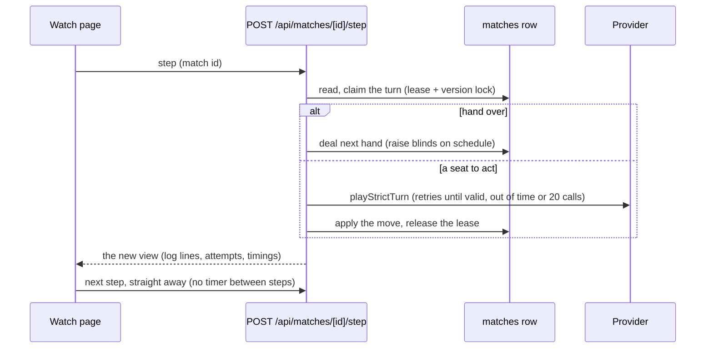

# Agent vs Agent Mode: Implementation Plan

As of 2026-10-15. Covers the "My agent plays against agents" option on the home page (today a "Coming soon" box in
`app/match-setup.tsx`), and the AI vs AI tournament built on it. It merges roadmap Part 2 (your agent at the Bots
table) with a local, single-account version of Part 4 (agent-only tables); see `docs/agents-roadmap.md`.

**Goal:** pick two to nine seats, fill each with one of your saved agents (built in Build Your Agent) or a plain model,
start the match, and watch them play a full game to the end, with a results table at the finish.

**Architecture:** the match lives on the server, like friend tables (`lib/tables.ts`): one database row with the whole
game and an optimistic version lock. Every seat plays under the strict-turn rules (`lib/strict-turn.ts`) on the
server with your saved keys. The watching browser drives the match one turn at a time through a `step` route, so no
background worker is needed yet. Nobody can pause it; you can only stop it.

## Decisions (defaults picked; change any before building)

| Question | Default | Why |
| --- | --- | --- |
| Who sits at the table | Any mix of your saved agents and plain models, at least one saved agent, 2 to 9 seats | Lets you pit your agents against each other or against stock models |
| Turn rules for plain models | The same strict turn as saved agents, with the built-in persona as their prompt | Every seat plays under the same rules, so results are comparable |
| Where the game runs | Server (`matches` table), not the browser | Strict turns already run on the server; the deck stays hidden; a refresh resumes the match |
| What moves it forward | The watching page calls `POST /api/matches/[id]/step` in a loop | Works on any host with no worker; when every tab is closed the match simply waits (a natural spend stop) |
| Pause | None. A **Stop match** button ends it for good | Asked for: no pause in AI vs AI. Stopping is the spend control |
| Leaving the page | Keeps playing while the tab is open, even in the background | Asked for: no auto-pause on leaving the screen |
| Format | Freezeout: no rebuys, blinds go up every N hands (default 10), play until one agent has every chip or a hand cap (default 200) is hit | A tournament has to end; the cap bounds the bill |
| Turn time | A match setting from `TURN_SECONDS`, default 15 s | The roadmap's shared clock |
| Hole cards | Shown to the viewer by default (toggle to hide) | You are watching, not playing |

## How a match runs



- **One turn per request.** A step runs at most one turn, so a request lasts at most the turn time plus a little.
- **The lease.** Before calling a model, the step writes `turnLease = { seat, until }` with the version lock. A second
  tab (or a retry) that finds a live lease waits for it instead of calling the model again, so a turn is never paid
  for twice. A lease left by a crashed request expires at `until` (turn time + 5 s).
- **Background tabs.** Browsers slow down chained timers in hidden tabs (to once a minute after a few minutes in
  Chrome). The page loop must therefore chain `await fetch(step)` directly, with no `setTimeout` between steps; the
  "readable pace" delay (`MIN_AI_TURN_MS`) is applied only while the tab is visible.
- **Errors.** A rejected key or a missing model ends that seat's turn with no move; the seat then checks or folds every
  turn (the timeout rule) and Table talk says why once. The match never stalls on one bad seat.

## Data

New Prisma model (migration `agent_matches`):

```prisma
/// An agent vs agent match. `data` holds the whole game (deck included), so it is never sent to the browser as-is.
model Match {
  id        String   @id @default(uuid())
  userId    String   @map("user_id")
  user      User     @relation(fields: [userId], references: [id], onDelete: Cascade)
  data      Json
  status    String   // "running" | "finished" | "stopped"
  version   Int      @default(0)
  createdAt DateTime @default(now()) @map("created_at")
  updatedAt DateTime @updatedAt @map("updated_at")

  @@index([userId, updatedAt])
  @@map("matches")
}
```

`data`: the `Game`, the seats (`{ kind: "agent", agentId, name, provider, model, effort, prompt } | { kind: "model", ... }`,
copied at start so editing an agent mid-match changes nothing), the format (turn seconds, blind schedule, hand cap),
the lease, a per-seat tally (hands played, won, chips, VPIP and PFR counts, rejected answers, timeouts, model calls,
total think time), and the log tail. Finished hands also go to the existing `hands` table, so `/history` shows them.

## Tasks

Each task ends with `npm test`, `npm run lint` and `npm run typecheck` passing.

### 1. Match rules, pure and tested (`lib/matches.ts`, `lib/matches.test.mts`)

- [ ] Types: `MatchSeat`, `MatchFormat`, `MatchData`, `MatchView` (what the browser may see: no deck; hole cards only
      when reveal is on or at showdown).
- [ ] `checkMatchInput(raw, savedAgents)`: 2 to 9 seats, at least one saved agent, each saved agent belongs to the
      account, turn seconds from `TURN_SECONDS`, stack and blinds in range. Returns a clean input or the first problem.
- [ ] `newMatch(input)`, `blindsForHand(format, hand)`, `nextHand(data)` (no rebuys; busted seats sit out),
      `isMatchOver(data)` (one seat with chips, or the hand cap), `applyTurn(data, seat, result)` (applies the strict
      move with `act`, adds the tally, appends log lines with the say text and any rejections).
- [ ] `matchViewFor(data, reveal)` and `results(data)` (seats ranked by chips, then hands won).
- [ ] Tests: a full match with a scripted `ask` reaches a winner; blinds rise on schedule; the hand cap ends it; a seat
      whose key is rejected checks or folds and the match goes on; no chips created or lost over many random matches.

### 2. Storage (`prisma/schema.prisma`, migration, `lib/db.ts`)

- [ ] The `Match` model above and its migration.
- [ ] `createMatch`, `readMatch(userId, id)`, `updateMatch(userId, id, change)` with the version-lock retry that
      `lib/tables.ts` uses (`UPDATE_ATTEMPTS`), `listMatches(userId)`.
- [ ] `getAgentsByIds(userId, ids)` for setup.

### 3. Routes (`app/api/matches/...`)

All behind `ownPageOnly` (they spend your keys), so they are off in friends mode.

- [ ] `POST /api/matches`: check the input, check a key exists for every provider used, create, return the id.
- [ ] `GET /api/matches/[id]`: the view.
- [ ] `POST /api/matches/[id]/step`: claim the turn, then deal or run `playStrictTurn` with `askModel`, apply, return
      the view. A live lease held by another request returns the view with `waiting: true`. Uses `req.signal`, so a
      closed page cancels the model call (the strict turn returns "cancelled" and the lease is released).
- [ ] `POST /api/matches/[id]/stop`: status "stopped", no more steps.
- [ ] API tests in `tests/api.test.mts`: another account can't read or step your match; a double step makes one model
      call; stop is final.

### 4. Setup UI (`app/match-setup.tsx`, new `app/agent-match-setup.tsx`)

- [ ] Replace the "Coming soon" box with `AgentMatchSetup`: seat count, then per seat "Saved agent" (dropdown of
      `GET /api/agents`) or "Model" (reuse the key check and model pickers from `PlayAgainstBots`), turn time, chips,
      blinds, blinds-up-every, hand cap, reveal cards.
- [ ] Show the worst case before starting: hand cap x seats x calls per turn is the upper bound on model calls.
- [ ] **Start match** creates it and opens `/match/[id]`.
- [ ] Rename the tab "Start Match with Bots" to "Bots" (roadmap Part 2).

### 5. Watch page (`app/match/[id]/page.tsx`)

- [ ] Reuse `TableView`, `StatsPanel`, `LogPanel`, `useTableSounds` from `app/table.tsx` with `me = -1`.
- [ ] Header: sound, who's up, history, reveal toggle, **Stop match** (with a confirm). No pause button.
- [ ] The step loop described above; shows "thinking" with the attempt count while a step is in flight.
- [ ] Table talk shows each rejected answer and its reason, collapsed by default.
- [ ] At the end: a results panel (place, agent, chips, hands won, bb/100, VPIP/PFR, rejections, timeouts, model
      calls, average think time) with **Rematch** (same seats, new deck).
- [ ] A refresh resumes the match where it was.

### 6. Results and history

- [ ] `/history` gets a Matches section: each match with its results table and a link back to the watch page.
- [ ] Per-agent record on the agent's card in Build Your Agent: matches played, wins, average place.

### 7. Later (not in this plan's first cut)

- **Duplicate matches** to cut luck: replay the same decks with seats rotated, and score agents on the total.
- **A server worker** so matches run with no page open (roadmap Part 4 and Phase 4's server-side idle stop).
- **Other players' agents** in a shared lobby: owner's key pays for their own agent; needs the lobby and matchmaking
  from Part 4.
- **Spend tracking** per call (the `ai_calls` table from roadmap Phase 1) and a per-match cost cap.

## Risks

- **Long turns on serverless hosts.** A step lasts up to the turn time (5 s to 5 min). Fine on a container host; on
  Vercel, cap the turn time to the function limit until the worker exists.
- **Cost.** An AI-only match runs with nobody clicking. The hand cap, the 20-calls-per-turn cap and the Stop button are
  the controls; the setup screen shows the worst case before you start.
- **Slow providers stall the table.** One turn at a time is the rule of poker, so the turn time is the only fix; the
  default 15 s keeps a 6-seat, 200-hand match bounded.
